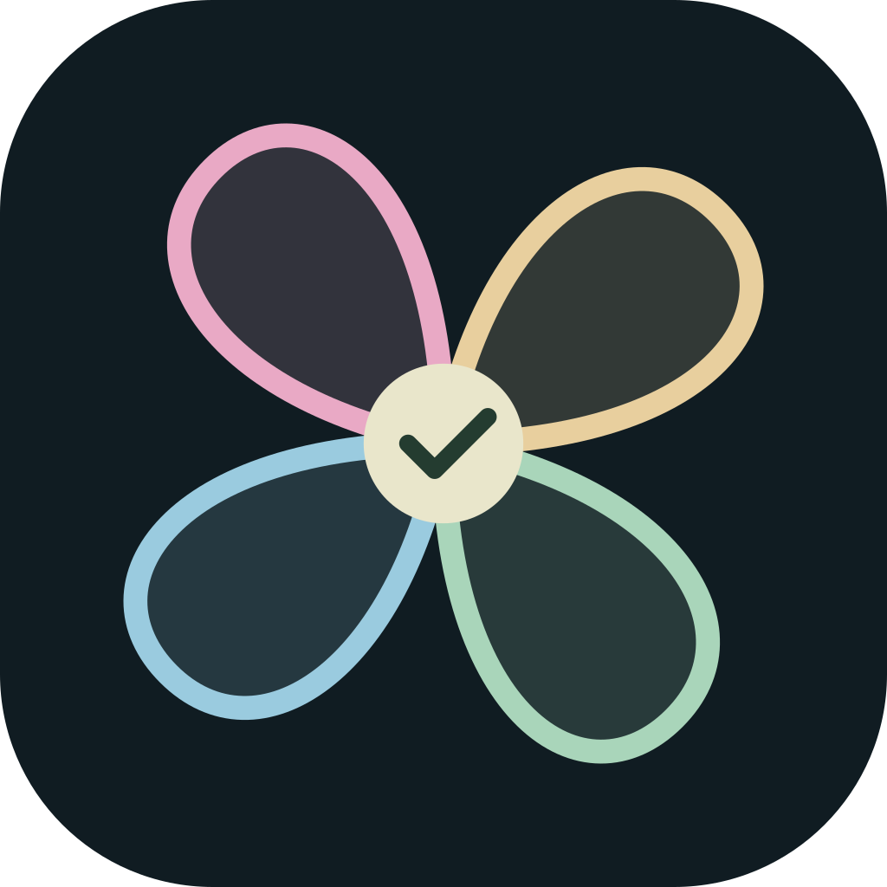
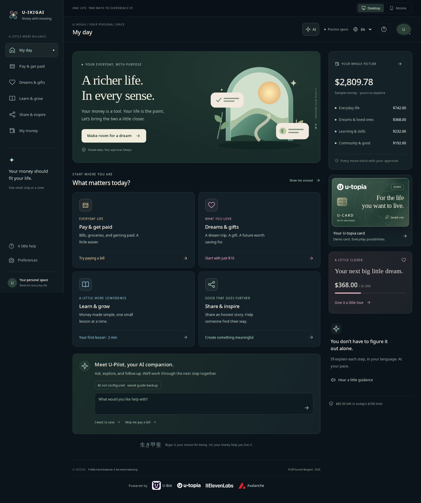
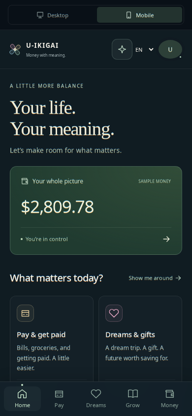

<p align="center">
  
</p>

<h1 align="center">U-Ikigai · 生き甲斐</h1>

<p align="center"><strong>U-topia With Meaning</strong></p>
<p align="center">Money should make room for life. Not take it over.</p>

<p align="center">
  U-Hackathon 2026 · FLOW Summit Bangkok<br />
  AI + Web3 prototype · English / ไทย / Español · Desktop + Mobile
</p>

<p align="center">
  <a href="#why-we-built-this">The idea</a> ·
  <a href="#see-the-experience">The experience</a> ·
  <a href="#run-it-locally">Run it</a> ·
  <a href="#built-to-be-inspected">Technical proof</a>
</p>

## Why we built this

**A utopia without purpose can still feel empty.**

We can build faster payments, smarter assistants and more ways to earn. But a better financial system should help us answer a more human question: *What is all of this for?*

For a freelancer, it might be the freedom to take a day off. For a shop owner, a little less worry at closing time. For a student, the courage to learn something new. For a parent, a small gift that says, “I believe in your future.”

U-Ikigai connects everyday money decisions to those reasons. Inspired by **生き甲斐 — the things that make life feel worthwhile** — it brings dreams, skills, community and daily needs into one calm experience.

You do not need to understand crypto to begin. You do not need to have your whole life figured out, either. A meaningful next step can be small. It can even be free.

**U-topia brings the possibilities. U-Ikigai helps people find their reason to use them.**

## See the experience



<details>
<summary>Open the dedicated mobile experience</summary>

<p align="center">
  
</p>

</details>

Actual application screenshots with sample data. Provider requests are disabled during screenshot capture; the images are not evidence of live AI availability.

## Four parts of life. One place to begin.

The four areas are our product framework, not a test that defines someone’s purpose or a claim that all ikigai fits four circles.

| What matters to you | Where you go | What you can do today |
| --- | --- | --- |
| **Everyday peace of mind** | Pay & get paid · Profession | Explore a sample bill or grocery order, review an income split, and generate a merchant payment QR card. |
| **Dreams and people you love** | Dreams & gifts · Passion | Build a sample saving plan, choose a dream or named recipient, and write a personal meaning note. |
| **Confidence in what comes next** | Learn & grow · Vocation | Translate unfamiliar financial terms, try practical lessons, compare illustrative fees, and earn learning XP. |
| **Something good beyond yourself** | Share & inspire · Mission | Rewrite risky promotional language, draft an honest community story, and create a short-video script with a referral QR. |

## Meet U-Pilot

U-Pilot is the app’s warm, practical AI companion. Ask a question, explore a goal, follow up, or hear an explanation in your language. Its shared Ikigai persona encourages manageable steps without turning every conversation into an investment pitch.

- **Live guidance through U-Bot:** contextual conversation, learning support, editable gift-note drafts, community captions, scripts and photo questions.
- **Read aloud through ElevenLabs:** English, Thai and Spanish, with clearly explained device-voice fallback when generated speech is unavailable.
- **Online first:** the app tries the live service automatically. Clearly labeled saved guides keep essential practice journeys available when connectivity or a provider fails; the next question tries online again.
- **You stay in control:** AI can explain or propose a supported example. It cannot approve a payment or execute a financial action.

Live conversation uses U-Bot, not an OpenAI API key. U-Pilot forwards arriving explanation text as a provisional draft; action buttons, follow-ups and read-aloud wait for complete validation. The provider may send an entire reply in one batch—there is no simulated typing timer. Photos are informational only; a photographed bill never authorizes a payment.

### Guidance is not permission

```text
Your question → explanation or proposed example → validation
             → your review → your explicit confirmation → sample receipt
```

Supported actions are checked against the person’s intent, sample balance and daily allowance. Invalid or mismatched model output cannot become an approval. Closing or cancelling a review does not spend anything.

## Designed to feel human

Familiar tasks come before financial terminology. Desktop has a spacious workspace and persistent money companion; mobile has its own home, touch-first navigation and approval sheet. The **生き甲斐 · IKIGAI** selector stays directly above the task it controls.

English, Thai and Spanish cover the interface, guides and key review journeys. Calm colors, optional narration and small, progressive steps help people explore at their own pace. Technical addresses, network settings and contract details stay inside **Preferences → Mentor Architecture View**.

## Built to be inspected

The calm surface is backed by inspectable code, validation and tests.

| Layer | Implementation |
| --- | --- |
| Product interface | Next.js 16 App Router, React 19, TypeScript, CSS and Framer Motion |
| Live AI | Server-side U-Bot adapter with login/token refresh, bounded conversation, cancellation, UTF-8 decoding and runtime output validation |
| Speech | Official ElevenLabs JavaScript SDK on the server, native browser MP3 playback, device voices and explicit fallback labels |
| Sample wallet | Integer-cent arithmetic, balance conservation, cumulative daily limits, confirmation-time checks and distinct demo receipts |
| Avalanche | Solidity `UIkigaiVault`, ethers.js and an optional Fuji C-Chain deployment/inspection workflow |
| Resilience | Local deterministic guides, device-local practice state and production service-worker caching after an initial visit |
| Verification | Playwright browser journeys, provider transport tests, wallet invariants, solc compilation and isolated EthereumJS contract execution |

### Avalanche: working code, clear boundaries

[`UIkigaiVault.sol`](./contracts/UIkigaiVault.sol) contains agent spending guardrails, allocation events and gift metadata. The mentor inspector can deploy it to **Avalanche Fuji C-Chain**, verify the network and deployed code, and submit records after browser-wallet confirmation. Existing deployments can also be connected.

The contract is compiled and executed in an isolated local EVM during tests. **This is not evidence of a public Fuji deployment.** The supplied contract does not transfer tokens, escrow assets or enforce gift-release dates. X-Chain settlement and a dedicated Avalanche L1 are architecture/roadmap ideas, not completed integrations.

### What this prototype does not claim

The main wallet uses **sample money**, not real financial settlement. Stock, gold, silver, fees and currencies are illustrative inputs—not live market quotes or executed purchases. U-Pay acquiring, U-Card checkout, real asset purchases and scheduled background payments are not connected. Caption rewriting is a drafting aid, not legal certification.

## Run it locally

Use Node.js **20.9 or later** and npm. From the repository directory:

```bash
npm ci --yes
npm run dev
```

Open [localhost:3000](http://localhost:3000). No provider credentials or wallet are needed to explore the sample tools and saved guides.

- [Desktop](http://localhost:3000/desktop): full workspace with sidebar and money companion.
- [Mobile](http://localhost:3000/mobile): dedicated mobile experience; small screens select it automatically.
- **Preferences → Start a fresh practice** resets the local sample ledger and progress.

### Connect live AI and speech

Create an ignored `.env.local` using the variable names in [`.env.example`](./.env.example). Keep all provider credentials server-only.

| Variable | Purpose |
| --- | --- |
| `UBOT_EMAIL`, `UBOT_PASSWORD` | U-Bot account login; use a rotated password. |
| `UBOT_TESTER_ID` | Account tester identifier, if supplied. |
| `ELEVENLABS_API_KEY` | Generated speech; optional for device-voice reading. |
| `NEXT_PUBLIC_VAULT_ADDRESS` | Optional **public** Fuji contract address—not a private wallet key. |

Restart the app after configuration. Open **Preferences → Mentor Architecture View → AI integration & connection**, then send a question and follow-up. Credential presence alone does not prove successful generation; check the reply’s actual source and speech fallback labels.

Optional bearer tokens, Supabase configuration, speech models and per-language voices are documented in the [AI integration guide](./docs/07_AI_EXPERIENCE.md).

**Never commit `.env.local`, passwords, bearer tokens or wallet keys. Never give provider secrets a `NEXT_PUBLIC_` prefix.** The credential-containing local `test.ipynb` notebook is also Git-ignored.

### Try the optional Fuji inspector

Open **Preferences → Mentor Architecture View → Optional live Fuji contract inspector**. Connect a browser wallet funded with **test AVAX**, then choose **Deploy vault on Fuji with my wallet** or enter an existing contract address. Confirm any network or transaction requests in your wallet yourself.

The inspector checks chain `43113` and contract code and links real submitted receipts separately from local demo receipts. Contract USD values are encoded in cents. This workflow does not turn the sample wallet into a payment processor.

### Share a hosted demo

The full app needs a host that runs **Next.js server routes**, such as [Vercel](https://vercel.com/docs/frameworks/full-stack/nextjs). A static-only upload cannot run the AI APIs. Deploying the web app and deploying an Avalanche contract are separate steps.

**Before enabling owner-funded AI accounts on an unrestricted public URL, add authentication, per-user usage limits and abuse controls, or restrict the demo to testers.** The prototype does not yet provide those public-service protections. You can host a saved-guide demo without provider secrets.

## A three-minute demo with a human story

1. **Start with a person, not a token.** Open `/desktop`, choose Thai, and show the familiar tasks. Ask what a little more peace of mind would look like.
2. **Make one everyday decision easier.** Try the Bangkok bill example. Review the amount, confirm it, and inspect the clearly labeled sample receipt.
3. **Give money a reason.** Choose Dreams & gifts, name someone you love, and create a small sample saving plan with a meaningful note.
4. **Show the companion.** Ask U-Pilot a question and a follow-up. Use Read aloud and show the actual provider or fallback label.
5. **Reveal the engineering.** Switch to mobile, then open the mentor drawer for traces, spending limits and the optional Fuji inspector. Finish with what this enables for an everyday person.

## Verification you can reproduce

Last streaming, voice and UX verification, **2026-10-16**: production build passed; production test suite **116 passed, 5 skipped**. The skipped tests are explicit opt-in real-provider checks, not silently counted as verified integrations. Two separately opted-in real ElevenLabs checks also passed. See the [AI verification record](./docs/07_AI_EXPERIENCE.md#streaming-and-connection-status-update) for provider batching limits and [SDK/live playback checks](./docs/07_AI_EXPERIENCE.md#elevenlabs-sdk-and-live-playback-fix).

```bash
npx --yes playwright install chromium
npm run build
npm test
```

To include actual production offline-reload checks, start the built app:

```bash
npm start
```

Then, in a second terminal:

```bash
TEST_BASE_URL=http://127.0.0.1:3000 TEST_PRODUCTION=1 npm test
```

Coverage includes 320–1440px layouts, all three languages, offline reloads, approval/cancellation, balance invariants, local contract execution, provider transport and failure behavior, all four attribution logos, and PNG exports. Routine tests replace live provider requests so they do not consume configured accounts.

Real U-Bot login, follow-up context and Thai persona behavior were checked separately. Real ElevenLabs generation and native browser playback also passed in English, Thai and Spanish; details and opt-in commands are in [the AI verification record](./docs/07_AI_EXPERIENCE.md#elevenlabs-sdk-and-live-playback-fix). Public Fuji deployment is not claimed. Audible quality depends on the device and voice.

## Explore the project

```text
src/app/api/             Server-only AI and speech routes
src/components/         Desktop/mobile UX, four task modules and mentor tools
src/lib/persona.ts      U-Pilot’s shared Ikigai persona
src/lib/ubot.ts         U-Bot authentication and request adapter
src/lib/wallet.ts       Sample ledger and confirmation guardrails
src/lib/presetData.ts   Deterministic saved guides and example data
contracts/              UIkigaiVault Solidity source
tests/                  Browser, provider, wallet and contract checks
public/branding/        High-resolution project logo PNGs
docs/                   Product vision, architecture and verification records
```

For a newcomer, start with [About This App](./ABOUT_THIS_APP.md). For implementation details:

- [Goal and judging](./docs/01_GOAL_AND_JUDGING.md) · [Design system](./docs/02_DESIGN_SYSTEM.md) · [Four-pillar specification](./docs/03_PILLARS_AND_FEATURES.md)
- [Avalanche and contract specification](./docs/04_AVALANCHE_AND_CONTRACT.md) · [Original stage pitch](./docs/05_STAGE_PITCH_AND_DEMO.md)
- [Implementation boundaries and verification](./docs/06_IMPLEMENTATION_AND_VERIFICATION.md) · [AI setup, privacy and experience](./docs/07_AI_EXPERIENCE.md)
- [Contributor operating rules](./AGENTS.md)

The first five documents preserve the original product vision. The implementation and AI guides distinguish working behavior from concepts that still require external integrations.

### Logo and attribution

Download the existing four-petal mark as a 1024 × 1024 [transparent PNG](./public/branding/u-ikigai-logo.png) or [dark app-icon PNG](./public/branding/u-ikigai-icon.png). Regenerate them with `npm run logo:export`. Refresh application screenshots against a running local production server with `npm run docs:screenshots`.

Submission assets: [16:9 cover and five screenshots](./docs/submission-media/README.md), or download the [complete upload ZIP](./docs/submission-media/u-ikigai-upload-pack.zip). All six upload images are 1920 × 1080 PNGs; screenshots use real application captures, and the cover illustration was generated separately.

The app’s **Powered by** row includes [U-Bot](https://u.bot), [U-topia](https://www.u-topia.com), [ElevenLabs](https://elevenlabs.io) and [Avalanche](https://www.avalanche.com). Original marks belong to their owners; attribution does not imply endorsement, partnership or an active provider connection. [Asset sources](./public/brands/README.md).

---

*A little more balance. A lot more meaning.*
